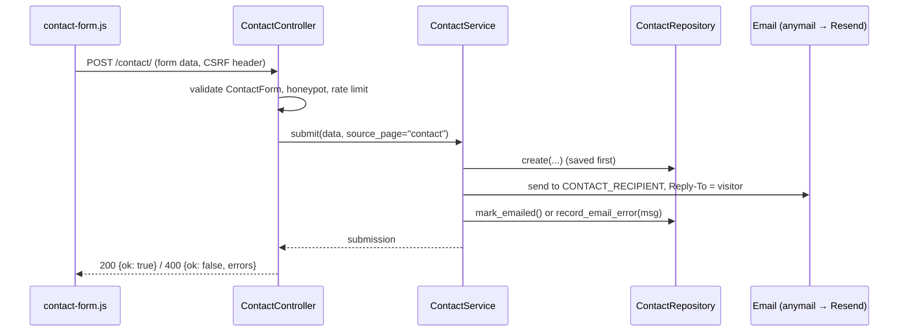
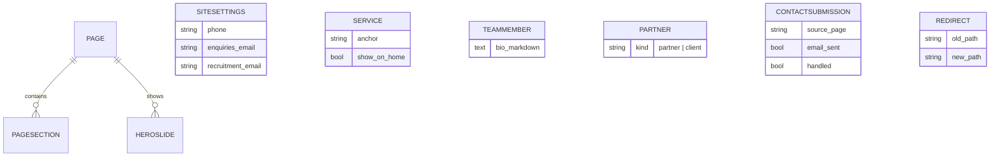

# Architecture

**Project-wide · revised 2026-11-04** (Day 6: team, partners, the page blocks; Day 5:
`ImageMixin`, pages and services as built, the seed; 2026-11-02: two phases; Resend; local media; VPS go-live)

The Distinctive Consultancy Services website: Django SSR, Postgres, Docker. It replaces the
existing WordPress (Divi) site. Phase 1 builds Home, About, Services and Contact and goes live;
Phase 2 adds Jobs and Search (`Phase_Gates.md`).

## 1. Why a layered architecture on a brochure site

A marketing site looks too simple to need layers. We use them anyway, for three reasons
specific to this project:

1. **Almost all content is admin-editable.** Page sections, slides, services, team, partners and
   site settings live in the database. Reading it in one consistent place (repositories) keeps
   templates simple and makes "published only" rules impossible to forget.
2. **The logic that matters is testable without a request.** Contact handling (save, then send,
   never lose a message), Markdown sanitising and, in Phase 2, the job rules and search all live
   in services with fast unit tests.
3. **It is a deliberate, reusable pattern** carried over from Consult 360, minus the interface
   layer (§3).

## 2. The five layers

```
Model  →  Repository  →  Service  →  Controller  →  View
```

| Layer | Responsibility | Lives in | May import |
|---|---|---|---|
| **Model** | Data shape and persistence (Django ORM) | `models.py` per app | Django, `apps.core.models` |
| **Repository** | Every database query. The only layer that calls `Model.objects` | `repositories/` per app | Models |
| **Service** | Business rules and orchestration (publishing rules, contact handling, Markdown, later jobs and search) | `services/` per app | Repositories, other services |
| **Controller** | Thin. Parses the request, calls a service, returns HTML or JSON | `controllers/` per app | Services, forms |
| **View** | Presentation: Django templates, Bootstrap, custom JS | `templates/`, `static/` | Controller context only |

**The rule that matters most:** controllers never call repositories or the ORM, and services never
call `Model.objects`. `apps/core/tests/test_layering.py` scans imports and source, and fails CI if
either happens.

**Documented exceptions (the only ones):**

- **The Django admin** reads and writes models directly. It is Django's own machinery, not our UI.
- **Data migrations and management commands** are operator tooling outside the layering. They
  may use the ORM, but prefer services: `seed_site_content` calls `SeedService`, which works
  through the pages, offerings and team repositories.
- **Signals** call a service, never the ORM: the users app's `post_migrate` handler calls
  `UserService.sync_content_editor_group`; Phase 2's search signals call `SearchIndexService`.

## 3. How this deviates from Django's MVT, and why it still works

| Django MVT | This project | Note |
|---|---|---|
| Model | Model | Unchanged |
| View (a function or class) | **Controller** | A Django "view" already behaves like an MVC controller. We keep it as a class-based view and make it thin. |
| Template | **View** | Templates are the presentation layer. |
| (queries inline in views, or fat models) | **Repository + Service** | The new layers. Queries move to repositories; rules move to services. |

Nothing fights the framework. URL routing, middleware, forms, the admin, sessions, CSRF, allauth
and the sitemap framework all work unchanged, because a controller *is* a `django.views.View`.

**No interface layer.** Consult 360 used `Protocol` interfaces for repositories. In Python they
added ceremony without protection, so here a service takes its repository through the
constructor, with a real default:

```python
class PageService(BaseService):
    def __init__(self, repo: PageRepository | None = None):
        self.repo = repo or PageRepository()
```

Tests pass a plain fake with the same method names (duck typing). `tests/` folders are excluded
from basedpyright, so a fake doesn't have to satisfy the `PageRepository` annotation. Same
testability, no extra files.

## 4. Shared building blocks (`apps/core`)

| Component | Purpose |
|---|---|
| `BaseModel` (abstract) | `created_at`, `updated_at`. Every model extends it. |
| `PublishableMixin` | `is_published`, `published_at`. |
| `OrderableMixin` | `sort_order`, with default ordering. |
| `SluggedMixin` | `slug` generated from a title field; unique. |
| `ImageMixin` | An optional `image` with `image_alt`, `image_decorative`, and the stored `image_width`/`image_height`. `clean()` requires a description unless the image is decorative; `alt_text` gives the attribute. Each model sets `image_upload_to` (`pages/sections`, `pages/slides`, `services`, `partners`, `team`). |
| `BaseRepository[T]` | `get` (raises `NotFoundError`, so ORM exceptions never reach services), `get_or_none`, `list`, `create`, `update`, `delete`, `exists`, `count`; `published()` for publishable models. Subclasses set `model`. |
| `BaseService` | Holds the repository; `get_or_raise` raising `NotFoundError`. |
| `ServiceError` family | `NotFoundError`, `ValidationError`, `ExternalServiceError`. Services raise these, never `Http404`. |
| `BaseController` (a `View`) | `render_page`, `json_ok`, `json_error`, `is_ajax`; maps `ServiceError` to responses (404, 400, 503). |
| `SeoMixin` + `SeoData` | Controllers return title, description, canonical and OG image; `_seo.html` renders them with JSON-LD. |
| `MarkdownService` + `{{ text\|markdown }}` | Markdown → sanitised HTML (`markdown` + `nh3`). **The only place HTML is made from admin text.** Allowed: `h2`–`h6` (a `# heading` becomes an `h2`; the page owns its `h1`), paragraphs, lists, emphasis, blockquotes, code, tables, links (`http`, `https`, `mailto`, `tel`, all with `rel="noopener noreferrer"`). Scripts and styles are removed with their contents. `to_plain_text()` gives the text without markup. |
| `SiteSettings` (singleton) | Phones, enquiries and recruitment emails, address, hours, footer blurb, social URLs, default meta and OG image, GA4 ID, map query. Always row 1 (a database check constraint); a data migration creates it with the old site's details. `SiteSettingsService` returns a `SiteDetails` value with `DEFAULTS` filling any empty field; the `site` context processor puts it in every template as **`site_info`** (not `site`, which allauth's views use for the Sites record). |
| `checks.py` | Start-up warnings for email misconfiguration (`deployment.md` §6). |
| `SeedService` + `seed/` | `manage.py seed_site_content` loads the old site's content (`seed/content.py`, images in `seed/images/`). It adds only what's missing, by each item's key (a section's anchor, a slide's heading, a service's anchor, a person's name, a logo's kind and name), and never changes what's there, so an editor's changes survive a re-run. Day 5 seeded Home and its six services, Day 6 About, its eight team members and two partners; Days 7 and 9 add the rest. |
| Nav list | The context processor's ordered nav items. Phase 2 adds Jobs and the search icon here. |

## 5. Request flow — worked example

**A visitor submits the contact form (AJAX).**



The submission is **saved before** the email is attempted. A provider failure never loses an
enquiry: it stays in the admin with `email_sent=False` and the provider's message, and an admin
action resends it.

**A visitor opens `/about/`.** `AboutController` (a `PageController` with `slug = "about"`) →
`PageService.get_page("about")` (the published page, its published sections and slides, in order;
`NotFoundError` → 404 if the page is unpublished) → `PageBlocksService.for_sections(sections)`,
which calls `TeamService.leadership()` because a section is a `team` block and
`PartnerService.partners()` because one is a `partners` block, and nothing else →
`pages/page.html`.

**A visitor opens `/`.** `HomeController` does the same with `slug = "home"` and
`pages/home.html`; its `service_cards` section brings in `OfferingService.home_cards()`
(published services ticked "show on Home", at most six).

Because the blocks are chosen by the sections, an editor can put the team, the logos or the
service cards on any page, and a page only queries for what it shows.

## 6. SSR with targeted AJAX

Pages render on the server. AJAX is used only where it helps: the contact and enquiry forms in
Phase 1; the search dropdown in Phase 2. A controller returns a full page or a JSON envelope from
the *same* service call, so there is no duplicated logic, and every form also works without
JavaScript.

JSON envelope: `{ "ok": true, "data": {...} }` or `{ "ok": false, "errors": {...} }`.

## 7. Content model



**As built (Days 5–6):**

- `Page`: one row per fixed page (`home`, `about`, `services`, `contact`), created by the
  migration `pages.0002_the_four_pages`, so every URL works on a fresh database. Title, published,
  and the search-engine title and description. The admin can't add or delete pages.
- `PageSection`: `section_type` (`hero_text`, `intro_dark`, `band_light`, `band_dark`,
  `two_column`, `value_block`, `service_cards`, `partners`, `clients`, `team`, `cta`), heading
  and its position, a short text (`intro`, the left column of `two_column`), Markdown body,
  optional image (`ImageMixin`) and its position, an optional button, order, published, and an `anchor`. The
  anchor is made from the heading when empty, unique within its page (`our-story`, `our-story-2`),
  and then kept, so links keep working when the heading changes. Editors restructure a page
  without a developer, and Phase 2 search can link straight to a section.
- `HeroSlide`: heading, subheading, optional image and button, order, published. Home only.
- `offerings.Service`: title, `anchor` (unique site-wide, same rules), summary (the Home card),
  Markdown body (the Services page, Day 7), image, `show_on_home`, order, published.
- `pages.Partner` (Day 6): `kind` (strategic partner or corporate client), name, caption,
  website, logo (`ImageMixin`), order, published.
- `team.TeamMember` (Day 6): name, job title, Markdown bio, photo, LinkedIn and Facebook URLs,
  order, published, and an `anchor` from the name (unique, kept), so a person can be linked to
  (`/about/#rose-nhamo`) and Phase 2 search can point at them.

**Phase 2 additions** (`Phase_2/Phase2_Scope.md`): `JobPosting`, and `SearchEntry` with one row per
searchable section, service, team member and open job.

## 8. Frontend (summary; see `frontend.md`)

Bootstrap 5 from npm; SCSS overrides Bootstrap's variables before importing it; compiled with
Dart Sass on the developer machine; only the compiled CSS is committed. Vanilla JS ES modules
for the contact form, cookie consent and (Phase 2) search and highlighting.

## 9. Deployment (summary; see `deployment.md`)

One Docker image, one web container per environment. Postgres data and uploaded media on named
volumes. Email through Resend's HTTPS API. GitHub Actions: lint, type check, tests and
`css-fresh` → build → push to GHCR. Production is a VPS running Docker Compose with Caddy
(automatic HTTPS, serves `/media/` from the volume), deployed by a manual workflow.
